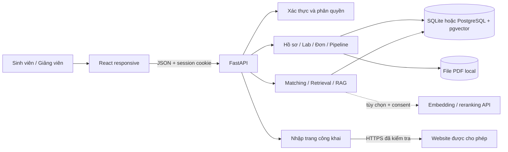
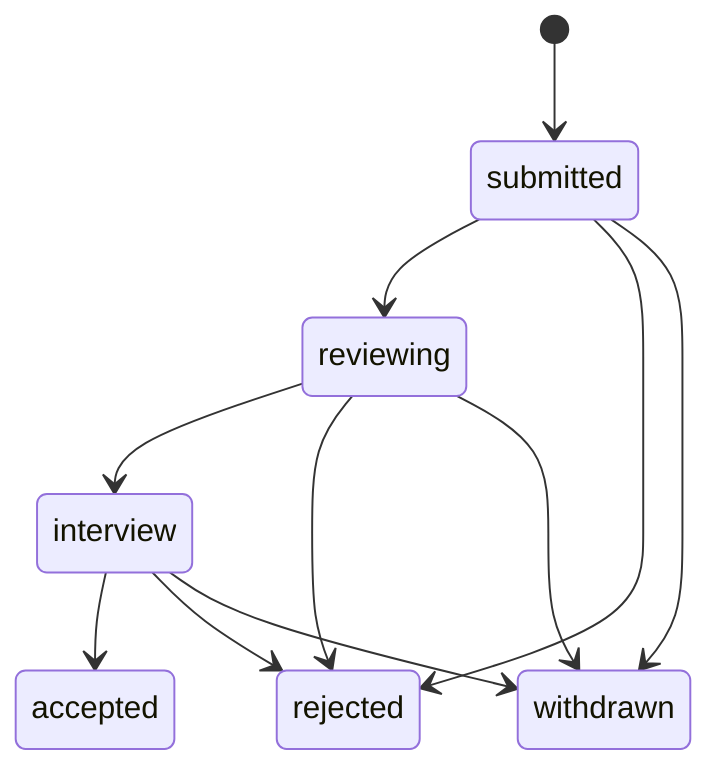

# Kiến trúc LabLink

## Quyết định thiết kế

Chọn **modular monolith**: một frontend và một API có các mô-đun nghiệp vụ. Nhóm 3 người có thể chia frontend, backend và AI; vẫn dùng một hợp đồng API và một database để giảm chi phí tích hợp. Chưa cần microservices, message broker hoặc Kubernetes.

Vite proxy `/api` trong development; Nginx phục vụ SPA và proxy API trong Compose. Cookie dùng cùng origin với frontend để luồng đăng nhập không phụ thuộc vào token trong localStorage.

## Phân chia mô-đun

| Mô-đun | Trách nhiệm | Không nên gộp vào |
|---|---|---|
| Auth | Đăng ký/đăng nhập, băm mật khẩu, session, lấy user hiện tại | Matching hoặc UI |
| Profile/Documents | Hồ sơ có cấu trúc, consent, lưu và tải PDF theo quyền | Nguồn bài báo công khai |
| Labs/Publications | Lab, chủ đề, điều kiện nhận, công trình có nguồn | Tự động tạo quyết định tuyển |
| Applications | Một đơn active/lab/sinh viên, file đính kèm, lịch sử chuyển trạng thái | Điểm AI |
| Intelligence | Phân tích câu hỏi, hard filters, vector, xếp hạng và nguồn | Quyền xem dữ liệu |
| Import | URL, kiểm soát truy cập mạng, xem trước và xác nhận nội dung | Crawl không giới hạn |

Quyền được áp dụng trước khi truy xuất/xếp hạng. Không lấy toàn bộ ứng viên rồi nhờ LLM “chỉ chọn người được phép”.

## Luồng sinh viên nộp hồ sơ

1. Sinh viên đăng nhập và khai báo GPA trên thang 4, kỹ năng, định hướng; việc gõ GPA không xác minh tính xác thực bảng điểm.
2. Upload CV/bảng điểm PDF. API kiểm tra loại, nội dung/kích thước và đặt tên storage riêng. PDF gốc được giữ riêng, không lộ thành thư mục static.
3. Chọn lab đang mở, viết thư ngỏ, nộp đơn. Hệ thống ràng buộc một đơn active trên cặp sinh viên–lab.
4. Liên kết file tại thời điểm nộp vào `application_documents` để giảng viên xem đúng những tệp đã nộp; upload mới không tự thay nội dung đơn cũ.
5. Giảng viên quản lý lab được xem đơn và chuyển trạng thái; sự kiện lưu actor, trạng thái cũ/mới và ghi chú.

GPA/skills khai báo của hồ sơ hiện tại có thể tiếp tục thay đổi; bản đầu chỉ snapshot **liên kết file**, chưa snapshot toàn bộ trường hồ sơ. Nếu cần dữ liệu bất biến cho đợt tuyển thật, thêm `application_profile_snapshot` có version.

## Pipeline và trách nhiệm quyết định

API xác minh quyền và bước chuyển hợp lệ. Các nhãn UI tương ứng: Nộp hồ sơ, Duyệt CV, Phỏng vấn, Chấp nhận, Từ chối, Đã rút. Năng lực lab được kiểm tra khi chấp nhận. AI không thực hiện bước chuyển nào.

## Retrieval, matching và chatbot

### Baseline local

Nội dung công khai của lab/công trình và thông tin hồ sơ được phép dùng tạo chunk. Ở vai giảng viên, CV đã gắn vào đơn không rút thuộc lab mình quản lý cũng được trích văn bản và truy xuất local. CV tải lên sau khi nộp chưa gắn đơn, CV thuộc lab khác và toàn bộ bảng điểm không vào nguồn truy xuất này. Token được chuẩn hóa, băm thành vector 256 chiều và chuẩn hóa để so khớp cosine. Đây là retrieval theo từ khóa với vector băm; không nên công bố nó có khả năng hiểu ngữ nghĩa như embedding được huấn luyện.

Khi câu hỏi khớp một đoạn CV, nguồn có thể dẫn tối đa 320 ký tự nguyên văn cùng link tải file đã kiểm tra quyền. CV chỉ hỗ trợ xếp hạng mềm và cung cấp bằng chứng; điều kiện GPA/skill/topic cứng vẫn dựa vào trường hồ sơ khai báo. Không tự nâng GPA hoặc bổ sung kỹ năng cứng từ lời viết trong CV.

Matching kết hợp các tín hiệu minh bạch như kỹ năng, chủ đề và điều kiện GPA, trả lý do và phần còn thiếu. Điểm không phải xác suất trúng tuyển. Chatbot dùng thông tin có cấu trúc và nguồn đã truy xuất để trả lời; không đoán trường dữ liệu còn thiếu.

Điểm gợi ý lab trong bản đầu:

`100 × (0,50 × tỷ lệ chủ đề lab trùng định hướng + 0,35 × tỷ lệ kỹ năng lab được đáp ứng + 0,15 × đạt GPA)`

Mẫu số là số chủ đề/kỹ năng lab, tối thiểu 1; `đạt GPA` bằng 0 hoặc 1. Đây là trọng số heuristic để minh họa, cần hiệu chỉnh bằng nhãn chuyên gia/người dùng. Gợi ý vẫn có thể hiển thị lab chưa đạt GPA kèm gap; API nộp đơn mới thực thi điều kiện tối thiểu. Điểm chatbot dùng tín hiệu retrieval riêng, không đồng nghĩa điểm matching này.

Câu “ReactJS, GPA > 3.2” được tách thành điều kiện định lượng và kỹ năng. `>` khác `>=`; các kỹ năng được yêu cầu đồng thời phải thỏa cùng lúc. Bộ lọc cứng hoạt động trước điểm tương đồng. Phần ngôn ngữ tự nhiên có phạm vi nhận diện hữu hạn; giao diện bộ lọc cấu trúc vẫn là công cụ kiểm tra/chỉnh lại ý định.

### Tích hợp tùy chọn

Với `AI_MODE=openai`, có khóa hợp lệ và consent phù hợp, API có thể tạo embedding 256 chiều và nhờ mô hình rerank danh sách ID đã được phép xem. Kết quả trình bày cuối cùng dựng từ dữ liệu đã có trong database; ID lạ không trở thành kết quả. Khi dịch vụ ngoài lỗi hoặc điều kiện không đủ, hệ thống trở về baseline local và thể hiện mode thực tế.

Đối với dữ liệu ứng viên, chỉ gửi GPA, danh sách kỹ năng và định hướng được khai báo. Nội dung lab/công trình công khai có thể gửi gồm tên lab, mô tả, chủ đề và bài báo. Phía query chỉ gửi bộ lọc có cấu trúc và, với câu tìm lab chung, kỹ năng/định hướng sinh viên để xếp hạng. Không gửi tên/email/bio cá nhân, câu hỏi nguyên văn, mật khẩu, session, CV/bảng điểm gốc hoặc văn bản trích từ chúng. Consent của người hỏi không thay thế consent của các sinh viên có dữ liệu trong truy xuất. Bật biến môi trường không tự tạo consent.

Không trộn các embedding từ mô hình hoặc chế độ khác nhau để tính điểm. Metadata của chunk ghi provider/model khi tích hợp; thay đổi model/dimension cần reindex. PostgreSQL lưu vector bằng pgvector; SQLite lưu mảng JSON và tính tương đồng trong ứng dụng. Chỉ thêm HNSW/IVFFlat sau khi đo tập dữ liệu đủ lớn và kiểm tra recall.

## Nhập dữ liệu nghiên cứu

Nguồn ưu tiên là website khoa/trường, trang lab hoặc dữ liệu giảng viên nhập có quyền sử dụng. Người dùng yêu cầu có nhắc Google Scholar; bản này **không có crawler Google Scholar**. Không vượt CAPTCHA, sử dụng cookie đăng nhập hay chặn của nguồn; có thể nhập thủ công URL, tiêu đề, abstract và năm.

URL import phải thuộc allowlist, là HTTPS cổng 443, DNS trỏ IP public; kiểm tra lại mỗi redirect, tuân thủ robots, có timeout và giới hạn HTML. Preview để giảng viên kiểm tra trước khi xác nhận lưu. Chỉ citation metadata được coi là bản ghi bài báo có thể lưu từ preview; HTML trang cá nhân không tự chuyển thành danh sách bài báo. Với trang chỉ có tóm tắt, chuyển tab nhập thủ công và giữ URL nguồn. Dữ liệu nguồn là nội dung không tin cậy; nội dung “hãy bỏ qua chỉ dẫn” trong trang không điều khiển agent hoặc LLM.

Với nhiều lab, đưa crawl/index sang worker và queue có retry/idempotency, cache source hash, lịch refresh và thông báo thay đổi để giảng viên duyệt. Bản đầu xử lý đồng bộ với giới hạn thời gian/kích thước.

## Quyền truy cập và dữ liệu cá nhân

| Dữ liệu/hành động | Sinh viên | Giảng viên |
|---|---|---|
| Thông tin lab/công trình công khai | Xem | Xem; sửa nếu là chủ lab |
| Hồ sơ sinh viên | Hồ sơ của mình | Ứng viên có đơn chưa rút vào lab mình quản lý |
| CV/bảng điểm | File của mình | File đính kèm đơn chưa rút thuộc lab mình quản lý |
| Nộp/rút đơn | Đơn của mình | Không thay sinh viên nộp đơn |
| Chuyển bước tuyển | Theo dõi | Đơn của lab mình quản lý |
| Chatbot ứng viên | Không tra hồ sơ sinh viên khác | Chỉ tập ứng viên được quyền xem |

Quyền tải và truy xuất CV yêu cầu ít nhất một đơn có liên kết file, không ở trạng thái withdrawn, thuộc lab của giảng viên. Rút một đơn không thu hồi quyền phát sinh từ đơn khác vẫn hợp lệ. Trong danh sách đơn đã rút của giảng viên, API ẩn tên/email/GPA/kỹ năng/định hướng, thư ngỏ và file; chỉ giữ trạng thái/lịch sử nghiệp vụ. Sinh viên vẫn xem được đơn của mình. Xóa file gỡ các liên kết và invalidation chunk; đổi hồ sơ/rút đơn cũng invalidation nội dung index liên quan. Lịch sử hội thoại chỉ nằm trong bộ nhớ màn hình, không được server lưu làm hội thoại; đoạn trả lời đã hiển thị không tự bị thu hồi trên một trình duyệt đang mở.

## Các trang đã hiện thực

| Trang | Đường dẫn | Hành vi |
|---|---|---|
| Tổng quan | `/` | Số liệu và bước tiếp theo theo vai trò |
| Khám phá phòng lab | `/explore` | Tìm/lọc/sắp xếp, lưu lab trên thiết bị, chi tiết, giải thích matching và nộp đơn |
| Hồ sơ/Quản lý ứng tuyển | `/applications` | Sinh viên theo dõi/rút; giảng viên Kanban kéo thẻ hoặc nút chuyển, ghi chú và lịch sử |
| Trợ lý nghiên cứu | `/assistant` | Truy vấn độc lập, kết quả có nguồn và chế độ retrieval |
| Hồ sơ của tôi | `/profile` | Sửa dữ liệu/consent; sinh viên upload, tải và xóa PDF |
| Phòng lab của tôi | `/manage` | Giảng viên tạo/sửa lab, gợi ý topic, thêm nghiên cứu bằng tay hoặc preview website |

Bookmark lưu trong localStorage theo tài khoản trên thiết bị, chưa đồng bộ server. Chuông cập nhật hiển thị trạng thái các đơn đã tải, không phải push notification. Giao diện chat hiển thị nhiều lượt nhưng backend không dùng lịch sử để hiểu tham chiếu qua lượt.

Không tìm kiếm vector chéo quyền truy cập. Session được lưu dạng hash token phía server, cookie HttpOnly, kiểm tra origin và yêu cầu header riêng cho mutation. TLS/cookie Secure, rate limit, xác minh giảng viên và quy trình quản trị bổ sung là điều kiện trước một pilot thực tế. Đăng ký vai giảng viên tự khai báo trong demo không chứng minh quan hệ với trường.

## Các giới hạn có chủ đích

- Web responsive, chưa có app native, push notification hoặc SSO.
- File local, chưa có object storage hoặc quét mã độc production; thử nghiệm chỉ dùng PDF giả lập.
- Parser PDF chạy tiến trình riêng, timeout 8 giây, tối đa 40 trang và 50.000 ký tự trích xuất; Linux bổ sung giới hạn bộ nhớ. Giới hạn này giảm rủi ro tài nguyên, không thay thế quét mã độc.
- GPA tự khai trên thang 4, chưa tích hợp hệ thống đào tạo hoặc OCR đối chiếu.
- Không có hệ thống migration lịch sử hoàn chỉnh; `create_all()` phù hợp khởi tạo demo, không nâng cấp schema đang chạy.
- AI không bảo đảm đánh giá năng lực và không được dùng như cơ chế tự động loại hồ sơ. Phải thực nghiệm và báo cáo baseline rõ ràng.

## Tài liệu kỹ thuật chính thức

Các lựa chọn kiến trúc ở trên dựa vào nhu cầu nhóm và code trong repository. Các tài liệu dưới đây dùng để đối chiếu hành vi nền tảng, không phải bằng chứng đã kiểm thử tích hợp:

- [FastAPI](https://fastapi.tiangolo.com/): validation theo kiểu Python, OpenAPI và tài liệu API tương tác.
- [Vite Getting Started](https://vite.dev/guide/): runtime Node hỗ trợ và luồng build/development.
- [pgvector](https://github.com/pgvector/pgvector): kiểu vector PostgreSQL, khoảng cách cosine, truy vấn chính xác và index ANN.
- [Official OpenAI documentation — Vector embeddings](https://developers.openai.com/api/docs/guides/embeddings): embedding và tham số `dimensions`; code chọn 256 chiều để dùng chung schema.
- [Playwright — Browsers](https://playwright.dev/docs/browsers): cài Chromium và chọn channel Edge/Chrome cho E2E.

Giá, quota và khả năng truy cập model tùy tài khoản; kiểm tra trực tiếp provider khi bật tích hợp, không suy ra từ một lần build local.
