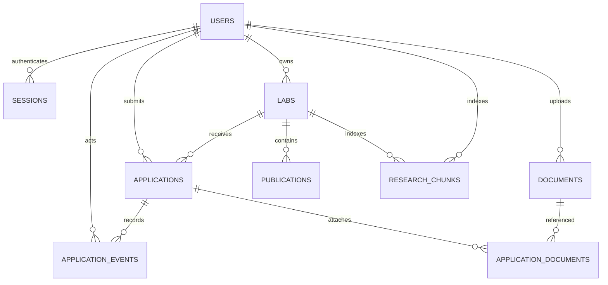

# Thiết kế database

Schema hiện thực nằm trong `apps/api/app/models.py`. Bản local dùng SQLite với foreign key bật; Compose dùng PostgreSQL 17 và extension pgvector. Tên cột dưới đây tương ứng code, không phải một schema đề xuất khác. Ngày giờ lưu UTC, giao diện đổi theo múi giờ khi hiển thị. Tất cả khóa chính đơn là integer tự sinh.

## ERD

## `users`

Dùng một bảng tài khoản/hồ sơ cho hai vai trò để tránh join không cần thiết ở quy mô cuộc thi. Các trường sinh viên có thể để trống ở giảng viên. Khi thêm nhiều loại hồ sơ sau này, có thể tách `student_profiles`/`lecturer_profiles` mà giữ nguyên `users.id`.

| Cột | Kiểu | Ràng buộc/mục đích |
|---|---|---|
| `id` | integer | PK |
| `name` | varchar(120) | Tên hiển thị |
| `email` | varchar(254) | Unique, index; chuẩn hóa lowercase tại API |
| `password_hash` | varchar(256) | Hash scrypt, không lưu mật khẩu rõ |
| `role` | varchar(20) | Check: `student` hoặc `lecturer` |
| `bio` | text | Giới thiệu/kinh nghiệm |
| `gpa` | float, nullable | Check 0–4; `NULL` nghĩa là chưa khai, khác GPA 0 |
| `skills` | JSON array | Các kỹ năng được khai báo |
| `interests` | JSON array | Chủ đề/định hướng nghiên cứu |
| `major` | varchar(160) | Ngành học |
| `year` | integer, nullable | Năm học; API kiểm tra 1–8 |
| `university` | varchar(200) | Trường/đơn vị |
| `website` | varchar(500) | URL hồ sơ, API kiểm tra HTTP/HTTPS |
| `consent_ai` | boolean | Mặc định false; đồng ý sử dụng các trường có cấu trúc trong chế độ AI ngoài |
| `created_at` | timestamptz | Thời điểm tạo |

GPA hiện là số thực cho demo. Nếu tích hợp học vụ cần độ chính xác/chính sách làm tròn, chuyển sang `NUMERIC(3,2)` và ghi `gpa_scale`/`verified_at`; không tự suy luận thang 4 từ bảng điểm thang 10.

## `sessions`

| Cột | Kiểu | Ràng buộc/mục đích |
|---|---|---|
| `id` | integer | PK |
| `token_hash` | varchar(64) | Unique, index; chỉ hash token được lưu DB |
| `user_id` | integer | FK `users.id`, index, cascade khi xóa user |
| `expires_at` | timestamptz | Index để kiểm tra hết hạn |
| `created_at` | timestamptz | Thời điểm đăng nhập |

Token ngẫu nhiên nằm trong cookie HttpOnly. Logout xóa session; phiên hết hạn bị từ chối. Chưa có trang quản lý tất cả thiết bị đăng nhập.

## `labs`

| Cột | Kiểu | Ràng buộc/mục đích |
|---|---|---|
| `id` | integer | PK |
| `owner_id` | integer | FK `users.id`, index; API yêu cầu giảng viên |
| `name` | varchar(160) | Tên lab |
| `slug` | varchar(180) | Unique, index; slug sinh kèm hậu tố ngẫu nhiên |
| `summary` | varchar(500) | Tóm tắt để tìm kiếm/hiển thị card |
| `description` | text | Mô tả nghiên cứu và công việc |
| `topics` | JSON array | Chủ đề nghiên cứu |
| `skills` | JSON array | Kỹ năng mong muốn |
| `min_gpa` | float | GPA tối thiểu; API kiểm tra 0–4 |
| `capacity` | integer | Check 1–100; số sinh viên có thể nhận |
| `location` | varchar(200) | Địa điểm |
| `website` | varchar(500) | Nguồn/trang lab |
| `is_open` | boolean | Có đang nhận hồ sơ hay không |
| `created_at`, `updated_at` | timestamptz | Thời điểm tạo/cập nhật |

Bản đầu một giảng viên sở hữu nhiều lab; một lab có một chủ sở hữu. Tuyển dụng gắn trực tiếp lab, chưa tách nhiều đợt/vị trí. Nếu chạy nhiều năm, thêm `recruitment_rounds` có deadline, số lượng và tiêu chí, rồi gắn application vào round.

## `publications`

| Cột | Kiểu | Ràng buộc/mục đích |
|---|---|---|
| `id` | integer | PK |
| `lab_id` | integer | FK `labs.id`, index, cascade |
| `title` | varchar(500) | Tiêu đề |
| `abstract` | text | Tóm tắt/nội dung được quyền dùng |
| `url` | varchar(1000) | URL nguồn để đối chiếu |
| `year` | integer, nullable | API kiểm tra 1950–2100 |
| `source` | varchar(100) | Nguồn nhập, mặc định `manual` |
| `topics`, `keywords` | JSON array | Nhãn/trích xuất phục vụ tìm kiếm |
| `created_at` | timestamptz | Thời điểm nhập |

Chỉ lưu nội dung và URL được phép sử dụng, không cam kết kho toàn văn bài báo. Chưa deduplicate theo DOI; giai đoạn sau bổ sung DOI chuẩn hóa, author và unique constraint phù hợp.

## `applications`

| Cột | Kiểu | Ràng buộc/mục đích |
|---|---|---|
| `id` | integer | PK |
| `student_id` | integer | FK `users.id`, index; API yêu cầu sinh viên |
| `lab_id` | integer | FK `labs.id`, index |
| `cover_letter` | text | Thư ngỏ; API kiểm tra 20–8.000 ký tự |
| `status` | varchar(20) | Index + check sáu trạng thái |
| `created_at`, `updated_at` | timestamptz | Thời điểm nộp/cập nhật |

Trạng thái hợp lệ: `submitted`, `reviewing`, `interview`, `accepted`, `rejected`, `withdrawn`.

Partial unique index **`uq_active_application(student_id, lab_id)`** chỉ áp dụng khi status thuộc `submitted/reviewing/interview/accepted`. Nhờ vậy không có hai đơn active trùng nhau, kể cả hai request cùng lúc. Đơn đã bị từ chối/rút không chặn lần nộp sau.

Khi nộp/chấp nhận, API khóa cập nhật lab và đếm số accepted trong transaction để kiểm tra capacity. Giảng viên cũng không thể giảm capacity xuống dưới số accepted đã có. Kiểm tra trạng thái và quyền ở ứng dụng vẫn cần thiết bên cạnh check constraint.

## `application_events`

| Cột | Kiểu | Ràng buộc/mục đích |
|---|---|---|
| `id` | integer | PK |
| `application_id` | integer | FK `applications.id`, index, cascade |
| `actor_id` | integer | FK `users.id` |
| `from_status` | varchar(20), nullable | `NULL` ở sự kiện tạo đơn |
| `to_status` | varchar(20) | Trạng thái mới |
| `note` | text | Ghi chú chuyển bước |
| `created_at` | timestamptz | Lịch sử có thứ tự thời gian |

Lịch sử tuyển chọn được ghi cùng transaction thay đổi đơn. Đây là lịch sử nghiệp vụ, chưa phải audit log chống sửa cho toàn hệ thống.

## `documents` và `application_documents`

| Cột `documents` | Kiểu | Ràng buộc/mục đích |
|---|---|---|
| `id` | integer | PK |
| `user_id` | integer | FK `users.id`, index, cascade |
| `kind` | varchar(20) | Check `cv` hoặc `transcript` |
| `filename` | varchar(200) | Tên hiển thị; không dùng làm đường dẫn lưu |
| `storage_key` | varchar(64) | Unique; định danh file do server sinh |
| `size_bytes` | integer | Giới hạn upload 5 MiB tại API |
| `extracted_text` | text | Trích xuất PDF local; CV có thể vào local RAG đúng phạm vi đơn; bảng điểm không index; không đưa văn bản tài liệu ra external AI |
| `created_at` | timestamptz | Thời điểm upload |

`application_documents` có khóa chính ghép `(application_id, document_id)`, hai FK tới đơn và file. Khi nộp đơn, API đính kèm các file đang có của sinh viên. Quan hệ giữ file đã nộp thay vì âm thầm lấy một CV mới tải lên cho hồ sơ cũ. Khi chính chủ xóa file, API xóa cả liên kết của các đơn trước; đây chưa phải kho snapshot bất biến. Rút đơn chặn quyền tải file của giảng viên qua đơn đó. Dữ liệu PDF nằm ở `STORAGE_DIR`; DB chỉ giữ metadata và văn bản trích xuất. Backup cần cả DB lẫn file.

Mô hình chưa có lifecycle retention tự động. Trước pilot thật phải xác định thời hạn giữ hồ sơ, xử lý yêu cầu xóa và tác động tới tài liệu đã gắn vào đơn, đồng thời bổ sung audit cho xóa/xuất dữ liệu.

## `research_chunks`

| Cột | Kiểu | Ràng buộc/mục đích |
|---|---|---|
| `id` | integer | PK |
| `content` | text | Nội dung chunk đã chọn cho truy xuất |
| `embedding` | JSON array | Vector dự phòng/phục vụ xử lý trong ứng dụng |
| `embedding_vector` | `vector(256)`; SQLite JSON | Vector native PostgreSQL, nullable |
| `source_type` | varchar(40) | Hiện dùng `lab` hoặc `student`; công trình gộp vào nội dung lab |
| `source_id` | integer | ID nguồn; kết hợp với `source_type` |
| `lab_id` | integer, nullable | FK `labs.id`, index, cascade |
| `user_id` | integer, nullable | FK `users.id`, index, cascade |
| `metadata_json` | JSON object | Provenance và chế độ/mô hình embedding |
| `created_at` | timestamptz | Thời điểm index |

Index ghép `ix_chunk_source(source_type, source_id)` phục vụ lookup/invalidation. `source_id` là tham chiếu đa hình nên không có foreign key trực tiếp sang mọi bảng; xóa/cập nhật nguồn phải invalidation chunk ở service. Cột `lab_id`/`user_id` cho biết chủ thể nguồn, không tự thay thế kiểm tra quyền. Trước mỗi retrieval, service lấy tập nguồn được phép từ quan hệ đơn/lab, dựng lại chunk tương ứng nội dung hiện có và chỉ tìm trên ID chunk đã được phép. Chunk local sinh viên có thể chứa CV đã gắn đơn của giảng viên đang truy vấn; external chunk chỉ chứa GPA/skills/topics.

Embedding 256 chiều của hai provider khác nhau không cùng hệ tọa độ. Metadata phải phân biệt model/provider và reindex khi đổi cấu hình. Hiện chưa tạo index ANN; pgvector hỗ trợ truy vấn cosine chính xác ở quy mô demo. Không ghi nhận một HNSW index hoặc hiệu năng production chưa được đo.

## Những ràng buộc ở API thay vì DB

- Role của người sở hữu lab/nộp đơn; phạm vi xem file/đơn và quyền giảng viên.
- Danh sách tag tối đa 30, mỗi mục 1–80 ký tự, loại trùng không phân biệt hoa thường.
- `min_gpa` 0–4, URL hợp lệ, thời gian năm công trình.
- Bước chuyển trạng thái, lab đang mở, đủ GPA và chưa đầy capacity.
- Consent và phạm vi dữ liệu trước khi đưa vào retrieval/provider AI.

Nếu cho công cụ khác ghi trực tiếp DB, cần đưa thêm ràng buộc thích hợp xuống schema và phân quyền DB, thay vì chỉ dựa vào validation FastAPI.

## Đường mở rộng và migration

1. Bổ sung Alembic, baseline schema đang có rồi tạo migration theo phiên bản. `create_all()` hiện chỉ tạo bảng còn thiếu, không đổi cột bảng cũ.
2. Tách bảng kỹ năng/chủ đề và bảng nối nếu cần taxonomy chuẩn, bộ lọc SQL quy mô lớn hoặc thống kê liên trường. JSON arrays hiện phù hợp seed/demo nhỏ.
3. Thêm recruitment round, profile snapshot và consent version/withdrawal log trước tuyển dụng thật.
4. Chuyển file sang object storage với signed URL qua kiểm tra quyền, quét mã độc và mã hóa backup.
5. Đo truy vấn, thêm index tổng hợp `(lab_id,status,updated_at)` hoặc ANN có kiểm chứng; không thêm index chỉ theo phỏng đoán.
